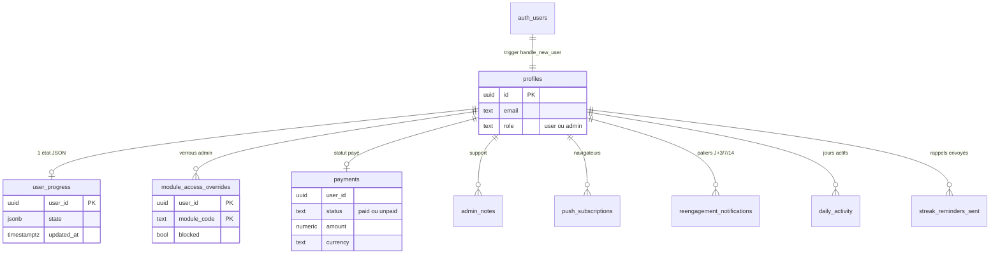
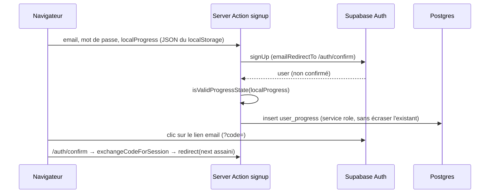
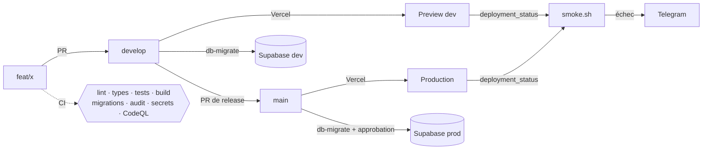

# Architecture — BRVM Learning

> Mise à jour : novembre 2026. Tenir ce document à jour dans la même PR que tout changement de structure (nouvelle table, nouvelle route API, nouveau service externe).

## 1. Vue d'ensemble

```mermaid
flowchart LR
  subgraph Clients
    A[Apprenant<br/>navigateur / PWA]
    AD[Admin]
  end

  subgraph Vercel
    P[proxy.ts<br/>garde de session]
    N[Next.js 16<br/>Server Components<br/>Server Actions]
    API["Routes API<br/>cron · health · monitoring"]
    CR[Vercel Cron]
  end

  subgraph Supabase
    AU[Auth<br/>email + mot de passe, PKCE]
    DB[(Postgres<br/>RLS)]
  end

  TG[Telegram<br/>canal d'alertes]
  UR[UptimeRobot]
  WP[Services Web Push<br/>FCM / APNs / Mozilla]
  WA[WhatsApp<br/>paiement manuel]

  A --> P --> N
  AD --> P
  A -. localStorage .- A
  N --> AU
  N --> DB
  A -- RPC merge_user_progress --> DB
  CR --> API --> DB
  API --> WP --> A
  N -- erreurs --> TG
  API -- erreurs / échecs cron --> TG
  UR -- sonde 5 min --> API
  UR --> TG
  A -. lien wa.me .-> WA
```

**En une phrase :** une app Next.js sur Vercel. Le contenu pédagogique est compilé dans le bundle. La progression vit dans `localStorage` pour un visiteur et dans Supabase pour un compte. L'accès payant est décidé côté serveur à partir d'une table `payments` que seul l'admin peut modifier.

## 2. Composants

| Composant | Où | Responsabilité |
|---|---|---|
| Garde de session | `proxy.ts` | Vérifie la présence d'une session (cookie seulement, aucune requête en base). Redirige vers `/login`. Liste blanche `ALWAYS_PUBLIC`. |
| Layout racine | `app/layout.tsx` | Lit la session et la progression serveur, puis les passe à `ProgressProvider` : pas de flash « invité ». |
| Moteur de module | `components/engine/*` | Lit **n'importe quel** module à partir d'un objet `Module` typé : Hero, slides, défi (quiz, simulateur, diagnostic), bilan. |
| Contenu | `content/modules/mXX.ts`, `content/registry.ts` | 28 modules typés, regroupés en 5 phases. `content/validate.ts` (`validateAll`) est vérifié par les tests et le build. |
| Store de progression | `lib/store.tsx`, `lib/progress.ts` | État `ProgressState`. Visiteur : `localStorage` (`brvm-learning:v1`). Compte : écriture debouncée vers le RPC `merge_user_progress`. |
| Règles d'accès | `lib/progress.ts::isPaywalled`, `lib/access.ts` | **Source unique** de « ce module est-il payant pour cet apprenant ? ». Un override admin l'emporte toujours. |
| Durées | `lib/duration.ts` | Calcule la durée de chaque module à partir de son contenu. Jamais saisie à la main. |
| Back-office | `app/admin/*`, `lib/actions/admin.ts` | Inscrits, paiements, notes, verrous de modules. Double contrôle : layout serveur + `requireAdmin()` dans chaque Server Action + RLS. |
| Crons | `app/api/cron/*`, `vercel.json` | Relance des inactifs (9 h), rappel de série (19 h). Authentifiés par `CRON_SECRET` (`lib/cron.ts`). |
| Observabilité | `instrumentation.ts`, `instrumentation-client.ts`, `lib/observability/*`, `app/api/health` | Erreurs serveur et navigateur → Telegram, logs JSON, sonde de santé. Voir [OBSERVABILITY.md](OBSERVABILITY.md). |
| Landing | `components/landing/*`, `app/landing.css` | Page publique servie sur `/` aux visiteurs. CSS entièrement scopé sous `.lp`. |

## 3. Données (Supabase / Postgres)



**Principes :**

- **RLS partout.** Chaque table a la RLS activée. Un utilisateur ne lit que ses lignes ; l'admin passe par `private.is_admin(auth.uid())`, une fonction `security definer` placée dans un schéma non exposé, ce qui évite la récursion RLS.
- **Aucune policy d'update sur `profiles.role`** : promouvoir un admin se fait en SQL, à la main.
- **Fonctions `security definer`** : toujours `set search_path = ''`, et `revoke execute … from public, anon` quand elles ne sont pas destinées au client (fonctions de cron réservées à `service_role`).
- **`merge_user_progress`** est en `security invoker` et fusionne l'état de façon atomique côté serveur : modules complétés unis, meilleur score conservé. Deux onglets ne s'écrasent pas.
- Les migrations vivent dans `supabase/migrations/` ; elles sont testées sur une base vierge par la CI et déployées par `.github/workflows/db-migrate.yml`.

## 4. Flux principaux

### Inscription avec reprise de la progression locale



### Ouverture d'un module payant

1. `proxy.ts` : une session est-elle présente ? Sinon, redirection vers `/login?next=…`.
2. `app/module/[code]/page.tsx` (serveur) lit `payments` et `module_access_overrides` de l'utilisateur, puis appelle `isPaywalled(code, status, overrides)`.
3. Si le module est verrouillé, l'écran de paiement renvoie vers **WhatsApp** (`lib/contact.ts`). L'admin passe ensuite `payments.status = 'paid'`.

### Synchronisation de la progression

Chaque changement de slide modifie l'état local. Pour un compte, une file *debounce + single-flight* (`lib/debounce.ts`) appelle `merge_user_progress` ; l'état fusionné renvoyé par la base remplace l'état local. C'est le chemin d'écriture le plus sollicité, et c'est lui que mesure `loadtest/progress-sync.js`.

## 5. Environnements et déploiement

| | Dev | Production |
|---|---|---|
| Branche Git | `develop` (+ previews de PR) | `main` |
| Vercel | Preview, URL stable `…-git-develop-…` | Production `brvm-training.vercel.app` |
| Supabase | projet **brvm-learning-dev** | projet de prod |
| Migrations | auto au push sur `develop` | push sur `main` + approbation manuelle |
| Alertes Telegram | préfixe `[PREVIEW]` | préfixe `[PRODUCTION]` |

Mise en place et variables : [ENVIRONMENTS.md](ENVIRONMENTS.md). Pipeline : [WORKFLOW.md](WORKFLOW.md).



## 6. Décisions d'architecture

| Décision | Pourquoi | Référence |
|---|---|---|
| Un moteur générique et des modules sous forme de données typées | 28 modules sans dupliquer de code UI ; le contenu est validé à la compilation | spec v0 `superpowers/specs/2026-07-22-…` |
| CSS Modules + jetons globaux, sans Tailwind | Reprise du POC ; ~9 000 lignes migrées par alias de jetons | [DESIGN-SYSTEM.md](DESIGN-SYSTEM.md) |
| Garde « optimiste » dans le proxy, contrôles d'autorisation au plus près des données | Le proxy tourne sur chaque requête : pas de requête en base à cet endroit | `proxy.ts` |
| Paiement manuel via WhatsApp | Marché UEMOA : mobile money, relation de confiance ; pas de PSP à intégrer en v1 | `lib/contact.ts` |
| Durées calculées depuis le contenu | Une durée saisie à la main finit toujours par mentir | `lib/duration.ts` |
| Observabilité maison (Telegram + UptimeRobot) plutôt qu'un APM | Zéro coût, zéro SDK, alertes là où l'équipe lit déjà ses messages | [OBSERVABILITY.md](OBSERVABILITY.md) |
| Deux projets Supabase (dev / prod) plutôt que Supabase Branching | Gratuit ; les previews n'écrivent plus jamais en prod | [ENVIRONMENTS.md](ENVIRONMENTS.md) |
| Portefeuille virtuel : le capital de formation reste un **score**, le cash vit dans des tables serveur | Séparer la pédagogie de la simulation boursière | `superpowers/specs/2026-10-16-portefeuille-virtuel-design.md` |

## 7. Limites connues

- **Free tier Supabase** : connexions et CPU limités, mise en pause après 7 jours d'inactivité (pour le projet dev). Voir [LOAD-TESTING.md](LOAD-TESTING.md) pour la capacité mesurée.
- **Le dédoublonnage des alertes est fait par instance serverless** : deux instances peuvent chacune notifier une fois.
- **Pas de CSP stricte sur les scripts** : elle demande des nonces (voir la roadmap).
- **Un apprenant peut modifier son propre `user_progress`** (RLS « update own ») : il peut tricher sur son score ou sur la progression de la phase gratuite, mais **pas** contourner le paiement, contrôlé par `payments` (écriture réservée à l'admin).
